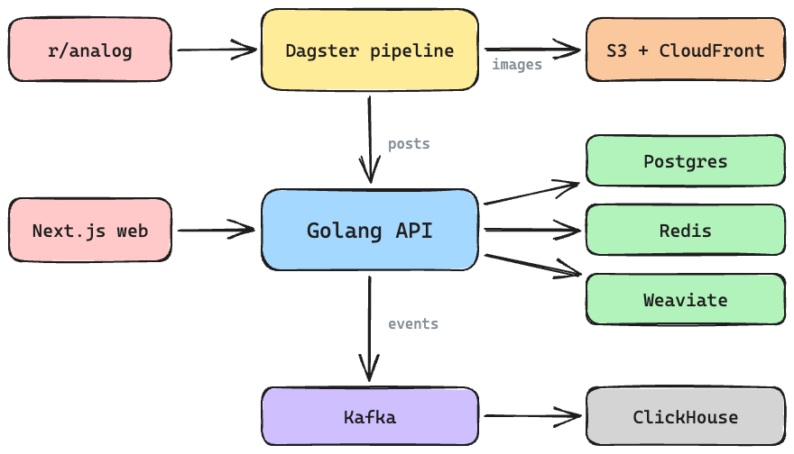

# AnalogDB

The collection of film photography

### About

[AnalogDB](https://analogdb.com) is a curated collection of 35k+ analog photographs, served through a REST API. Beyond just returning photos, AnalogDB tags each image with the camera and film it was shot on, writes a caption describing it, finds visually similar images, adds keyword labels, extracts dominant colors, and allows for filtering, sorting and searching by phrase across the whole collection.

### Design

AnalogDB makes use of several technologies and services to enable a full featured product.


<br/><br/>

Data is scraped from r/analog with [praw](https://github.com/praw-dev/praw) and run through a pipeline orchestrated by [Dagster](https://github.com/dagster-io/dagster). Along the way an LLM reads each post title to pull out the camera, film and lens, a vision model writes a caption for each image, images are resized, and keywords and dominant colors are extracted. Images are uploaded to [AWS S3](https://aws.amazon.com/s3/) and served from [CloudFront CDN](https://aws.amazon.com/cloudfront/) for quick and reliable delivery, and posts are created through the backend API with a generated Python client. Scheduled jobs keep scores and keywords fresh over time.

The core backend application is written in Go and makes use of [chi](https://github.com/go-chi/chi) as the HTTP router. It exposes versioned handlers under `/v1` that are responsible for parsing authentication headers, filtering incoming requests, querying databases, and returning JSON responses. Posts live in PostgreSQL, with [Redis](https://github.com/redis/redis) caching hot responses. Upon upload, all images are embedded with [CLIP](https://github.com/mlfoundations/open_clip) and stored in a [Weaviate](https://github.com/weaviate/weaviate) vector database, which powers both similarity search and searching photos by phrase. The backend is packaged as several docker containers and hosted on a VPS.

The frontend web application is built with [Next.js](https://github.com/vercel/next.js/) using the App Router, with server-side rendering for quick loading pages. Alongside the gallery there are pages for search and for browsing by film and camera. Components come from [Mantine](https://github.com/mantinedev/mantine) and styles are written with [CSS Modules](https://github.com/css-modules/css-modules). It talks to the backend through a TypeScript client generated from the OpenAPI spec.

The backend also publishes analytics events to [Kafka](https://github.com/apache/kafka). A small Go consumer reads them off the topic and writes them into [ClickHouse](https://github.com/ClickHouse/ClickHouse) for querying later. Everything is instrumented with OpenTelemetry, with traces in Tempo, logs in Loki and metrics in Prometheus, all viewed through Grafana.

### API

Full documentation for the API: <https://api.analogdb.com/>

### Example

```bash
curl "https://api.analogdb.com/v1/posts?page_size=1"
```

```json
{
  "meta": {
    "total_posts": 38246,
    "page_size": 1,
    "next_cursor": "eyJzIjoidGltZSIsInYiOjE3OTQwMDM1MzUsImlkIjo1NTQ2OX0",
    "next_page_url": "/v1/posts?cursor=eyJzIjoidGltZSIsInYiOjE3OTQwMDM1MzUsImlkIjo1NTQ2OX0&page_size=1&sort=time"
  },
  "posts": [
    {
      "id": 55469,
      "title": "NYC - Halloween 2026 [ Nikon F2 | 28mm f/2.8 | Cinestill 800T ]",
      "author": "maxt21",
      "permalink": "https://www.reddit.com/r/analog/comments/1xppww4/nyc_halloween_2026_nikon_f2_28mm_f28_cinestill/",
      "description": "Had fun shooting Halloween this year in Brooklyn. Last year I did the same and it was a lot of fun. This year was also a lot of fun",
      "caption": "A man with yellow face paint and a small anchor decoration on his head smiles at the camera in a subway station.",
      "score": 108,
      "nsfw": false,
      "grayscale": false,
      "timestamp": 1794003535,
      "sprocket": false,
      "camera_make": "nikon",
      "camera_model": "f2",
      "film_make": "cinestill",
      "film_type": "800t",
      "film_speed": 800,
      "focal_length": 28,
      "aperture": "f/2.8",
      "images": [
        {
          "resolution": "low",
          "url": "https://i.analogdb.com/4044cdd36cc7e86d8065660c-low.jpeg",
          "width": 720,
          "height": 720
        },
        {
          "resolution": "medium",
          "url": "https://i.analogdb.com/4044cdd36cc7e86d8065660c-medium.jpeg",
          "width": 1080,
          "height": 1079
        }
      ],
      "colors": [
        {
          "hex": "#101111",
          "css": "black",
          "html": "black",
          "percent": 0.24719358
        },
        {
          "hex": "#2f2d33",
          "css": "darkslategray",
          "html": "black",
          "percent": 0.22062495
        }
      ],
      "keywords": [
        { "word": "man", "weight": 1 },
        { "word": "halloween", "weight": 0.9583 }
      ]
    }
  ]
}
```

The response has been truncated here, real posts come with four image sizes, five colors and more keywords.

### Deploying

There are prebuilt docker images on Docker Hub:

- `evanofslack/analogdb` for the backend API
- `evanofslack/analogdb-web` for the frontend
- `evanofslack/analogdb-dagster` for the scraping pipeline
- `evanofslack/analogdb-consumer` for the analytics consumer

Each service has its own `docker-compose.yaml` (in [backend](backend/docker-compose.yaml), [web](web/docker-compose.yaml), [scrape](scrape/docker-compose.yaml) and [consumer](consumer/docker-compose.yaml)) with the necessary variables and services for an example deployment.

### Developing

Tasks run through [just](https://github.com/casey/just), and running `just` on its own lists every recipe.

To set up the docker network and install dependencies:

`just setup`

To spin up the backend, consumer, web and infra containers:

`just up`

To run all the tests:

`just test`

To serve the frontend locally:

`just web dev`

To run the Dagster pipeline locally:

`just scrape dev`

### Contributing

All contributions are welcomed and encouraged. Please create a new issue to discuss potential improvements or submit a pull request.
